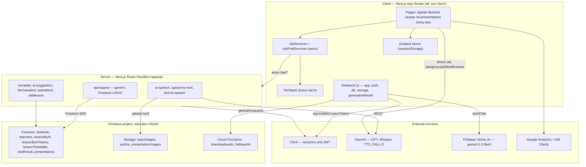

# LearnX3

> An AI-assisted English language learning platform for students, teachers, and admins — AI-generated curricula, voice conversation practice, lesson scheduling, and assessment tracking.

## Overview

LearnX3 is a Next.js App Router application that gives English learners AI-generated lesson content and spoken conversation practice, while giving teachers tools to schedule lessons, generate slide decks, and track student results. Content (topics, lessons, presentations) is generated on demand by OpenAI and Google Gemini and persisted to Firestore.

The whole application sits behind authentication — the root layout wraps every route in Clerk's `<SignedIn>` and redirects signed-out visitors to sign-in, so there is no public marketing surface in this repo. Roles (`student` / `teacher` / `admin`) drive navigation and per-page access.

Status: private, pre-1.0 (`version: 0.1.0`, `private: true`). No CI pipeline, no test suite, and no deployment config are committed to this repo.

## Features

Verified in code — each maps to a route or component in `app/`.

- **Role-based dashboards** — student, teacher, and admin dashboards at `/`, `/home`, `/home/teacher`, `/home/admin` (`app/page.tsx` branches on `userInfo.role`).
- **AI curriculum generation** — enter a topic, get a full lesson (vocabulary, phrases, conversation, questions, multiple-choice exercise) plus a DALL·E 3 cover image, saved to Firestore (`app/components/dashboard/CreateAiLesson.tsx`).
- **Speaking topic library** — browsable, searchable, category-filterable topic grid at `/speak`, with a per-lesson practice page at `/speak/[id]` (flash cards, phrases, conversation, questions, self-assessment).
- **Voice conversation with a 3D avatar** — record audio → Whisper transcription → GPT reply → TTS audio → animated Three.js avatar at `/avatar` (`app/components/Chat/`).
- **Fina AI tutor chat** — text chat backed by Firebase Vertex AI (Gemini 1.5 Flash), with Markdown rendering (`app/fina/`).
- **AI presentation generator** — generates a structured slide deck from a topic via OpenAI JSON-schema structured output, with in-place slide editing, fullscreen presenting, and PDF export (`app/ai-presentations/`).
- **Lesson timetable** — teachers create scheduled lessons; students see upcoming lessons filtered by subscription type (`/lessons`).
- **Entry proficiency test** — 10-question shuffled quiz mapping score to a CEFR band A0–C2 (`app/entry-test/`).
- **Assessment and results** — test submission and per-student result views with Chart.js visualisations (`/student/[id]`, `/student/results`).
- **Inline translation** — hover/select-to-translate powered by an OpenAI translation route (`app/api/translate`).

## Tech Stack

| Layer | Technology | Notes |
|---|---|---|
| Framework | Next.js 14.2 (App Router) | `app/` directory; nearly all components are `"use client"` |
| Language | TypeScript 5.0.4 | `strict: true`, path alias `@/*` → `./app/*` |
| UI | React 18.3, MUI 5.10 + Emotion 11 | `reactStrictMode: false` in `next.config.js` |
| 3D | three 0.165, @react-three/fiber 8, @react-three/drei 9 | Avatar rendering on `/avatar` |
| Server state | TanStack Query v4 (+ devtools) | `QueryClientProvider` in `app/layout.tsx` |
| Client state | Zustand 4 | Several stores in `app/components/zustand.js`; user/lesson stores persist to `sessionStorage` |
| Auth | Clerk (`@clerk/nextjs` 4.31) | `authMiddleware` in `middleware.ts`; JWT exchanged for a Firebase custom token |
| Database | Cloud Firestore (`firebase` 11.2 client SDK) | Called from Next.js Route Handlers, not the Admin SDK |
| Storage | Firebase Storage | Topic/presentation images, generated and recorded audio |
| AI — OpenAI | `openai` 4.26 | `gpt-4o-mini`, `gpt-4o-2024-08-06`, `whisper-1`, `tts-1`, `dall-e-3` |
| AI — Google | `@firebase/vertexai` 1.0 | `gemini-1.5-flash` via Firebase Vertex AI, browser-side |
| Charts / export | chart.js 4 + react-chartjs-2 5, jspdf 2.5 + html2canvas 1.4 | Result charts; presentation → PDF |
| Serverless | Firebase Cloud Functions (`functions/`, Node 18) | `firebase-functions` v5, `firebase-admin` v12 |
| Analytics | Google Analytics (gtag), Microsoft Clarity | Clarity initialises only when `NEXT_PUBLIC_NODE_ENV === "production"` |
| Formatting | Prettier | Tabs, no semicolons, 120 print width (`.prettierrc`) |
| CI/CD | — | None committed |

## Architecture

Three tiers, all inside one Next.js deployment plus a Firebase project. The **client** is a fully client-rendered MUI app: pages fetch through a hook-based service layer (`ApiServices` / `ApiPostServices`) that wraps axios calls to internal Route Handlers. The **server** is a set of Next.js Route Handlers under `app/api/*` that check the Clerk session with `getAuth(request)` and then talk to Firestore, Firebase Storage, and OpenAI. A deliberate exception: two AI paths (presentation generation, lesson generation, and the Fina chat) call OpenAI and Vertex AI **directly from the browser**, bypassing the API layer entirely.

Authentication is two-headed. Clerk owns the session; a Clerk JWT minted from the `integration_firebase` template is exchanged via `signInWithCustomToken` for a Firebase Auth session, so the Firebase SDK's `currentUser.uid` becomes the join key for the `students` / `teachers` Firestore documents.



### Project Structure

```
app.learnx3/
├── app/                          # Next.js App Router — everything lives here
│   ├── layout.tsx                # Root: Clerk + TanStack Query + Clarity + GA providers
│   ├── page.tsx                  # Role router: student -> /home, teacher -> /home/teacher
│   ├── api/
│   │   ├── ApiServices.tsx       # Client-side GET service layer (axios)
│   │   ├── ApiPostServices.tsx   # Client-side POST/PATCH service layer
│   │   ├── apirequest/           # Generic Firestore CRUD by ?collectionName=
│   │   ├── ai-speech/            # Whisper transcript -> GPT reply -> TTS mp3 -> Storage
│   │   ├── speech-to-text/       # whisper-1 transcription
│   │   ├── text-to-speech/       # tts-1 synthesis -> Storage
│   │   ├── translate/            # gpt-4o-mini translation
│   │   ├── ai-suggestion/        # Suggested next reply in conversation practice
│   │   └── fetch*/ submittest/ addlesson/ updateteacher/   # Typed Firestore endpoints
│   ├── components/
│   │   ├── firebaseX.js          # Firebase app/auth/db/storage + Vertex AI model init
│   │   ├── zustand.js            # All client stores (user, lesson, chat, presentation)
│   │   ├── auth/ProtectedRoute   # Role + `permit` gate wrapping each page
│   │   ├── hooks/userDetails.tsx # Clerk -> Firebase token exchange, loads user doc
│   │   ├── Chat/                 # Voice loop + Three.js avatar (Experience, Avatar, SpeakAI)
│   │   ├── dashboard/            # Dashboard widgets incl. CreateAiLesson generator
│   │   ├── speakpage/            # FlashCards, Phrases, Conversation, SpeakAssessment
│   │   ├── lessons/ student/ teacher/ assessment/ pricing/  # Feature components
│   │   └── helpers/ utils/ constants/ elements/ ui/         # Shared plumbing
│   ├── fina/                     # Gemini-backed AI tutor chat UI
│   ├── ai-presentations/         # Deck list, generator, viewer, PDF export
│   ├── speak/ lessons/ student/ home/ entry-test/ avatar/ user-settings/  # Routes
│   ├── auth/                     # Post-signup student and teacher profile forms
│   ├── types/                    # Domain types (UserType, LessonType, LessonTimetableType)
│   └── depreciated/              # Retained legacy component (sic)
├── functions/                    # Firebase Cloud Functions (Node 18, JS)
├── types/quizType.ts             # Entry-test quiz types
├── middleware.ts                 # Clerk authMiddleware over all non-static routes
├── firebase.json / .firebaserc   # Firestore + Storage rules, Functions codebase
├── firestore.rules               # Currently: any authenticated user, any document
└── y                             # Storage rules file (name referenced by firebase.json)
```

### Data Flow

The voice conversation loop on `/avatar` is the most representative end-to-end path:

1. `app/avatar/page.tsx` renders a `<Canvas>` (`Experience` → `Avatar`) alongside `ChatPage`, both gated by `ProtectedRoute`.
2. `UseAudioRecorder.tsx` captures microphone audio via `react-media-recorder`, then uploads the blob to Firebase Storage at `audios/{uid}/my-speech-{timestamp}` and resolves a download URL.
3. That URL is handed to `useSpeakAI().Speak()` (`components/Chat/SpeakAI.tsx`), which POSTs it to `/api/speech-to-text`.
4. `app/api/speech-to-text/route.ts` fetches the audio from the Storage URL, converts it to a file stream, and transcribes it with `whisper-1`.
5. The transcript is appended to the `useChatStore` message array, and the whole array is POSTed to `/api/ai-speech`.
6. `app/api/ai-speech/route.ts` calls `gpt-4o-mini` for a reply, synthesises it with `tts-1` (voice `alloy`), uploads the mp3 to `audios/{userId}/ai-speech-{timestamp}-{userId}.mp3`, and returns both the text and the audio download URL.
7. The client stores the audio path in `useStoreFilePath`, appends the assistant message to the chat store, and the avatar animates while the returned mp3 plays.
8. Separately, `handleSuggestion` in `ChatPage.tsx` can POST the conversation to `/api/ai-suggestion` for a hint, then to `/api/text-to-speech` to voice it.

Session enforcement across these steps is uneven. Clerk's `authMiddleware({})` in `middleware.ts` matches `/(api|trpc)(.*)` with no `publicRoutes`, so it is the primary gate. In-route checks are a second layer: `/api/ai-speech` and `/api/text-to-speech` call `getAuth(request)` only to namespace the Storage path and never reject a missing `userId`, and `/api/speech-to-text` does not call it at all. Ten of the fifteen Route Handlers do return `401 Not authenticated`; see Known Limitations for the full split.

### Key Design Decisions

- **Generic CRUD endpoint** — `app/api/apirequest/route.ts` takes `?collectionName=` and proxies POST/GET/PATCH/PUT/DELETE to any Firestore collection, converting `createdAt` / `lesson_date` between ISO strings and Firestore `Timestamp` at the boundary. Trade-off: one endpoint covers most screens, but the collection name is caller-controlled and the role check inside it is disabled (see limitations).
- **Firebase client SDK on the server** — Route Handlers import `db` and `storage` from `app/components/firebaseX.js` (the browser SDK) rather than `firebase-admin`. `firebase-admin` is installed but only used inside `functions/`. Consequence: server routes operate under Firestore security rules as an unauthenticated client, not with admin privileges.
- **Clerk for sessions, Firebase for identity** — `useUserDetails` mints a Clerk JWT from the `integration_firebase` template and calls `signInWithCustomToken`, so `firebase/auth`'s `currentUser.uid` is the document key in `students` / `teachers`. This keeps Clerk's sign-in UX while letting Firestore rules and Storage paths key off a Firebase uid.
- **Two-step authorisation** — `ProtectedRoute` checks both `userInfo.permit` (an admin-granted boolean; unapproved users see a waiting page) and membership in a per-page `permitArray` of roles.
- **`sessionStorage` for user state** — the Zustand `current-user` and `english-lesson` stores persist to `sessionStorage`, not `localStorage`, so profile and lesson state resets per browser tab session.
- **Direct browser AI calls for generation** — presentation and curriculum generation call OpenAI from the client with `dangerouslyAllowBrowser: true`, and Fina chats with Gemini via the Firebase SDK. This skips the Route Handler layer and its request-size and timeout limits, at the cost of exposing the OpenAI key (see limitations).
- **Structured output for presentations** — deck generation pins `gpt-4o-2024-08-06` and passes `response_format: { type: "json_schema" }` with `presentationSchema.json`, plus `presentationContent.json` as a worked example in the system prompt, so slides parse deterministically into the `PresentationContent` type.

### Data Model

Firestore collections (no schema file — these are the names referenced in code):

| Collection | Key fields | Notes |
|---|---|---|
| `students` | doc id = Firebase uid; `name`, `email`, `role`, `permit`, `eng_level_form`, `eng_level_test`, `subscription_type`, `paid`, `num_of_lessons_left` | Shape defined by `UserType` in `app/types/types.tsx` |
| `teachers` | doc id = Firebase uid; `TeacherType` subset plus `qualification`, `permit` | `useUserDetails` looks here first, then falls back to `students` |
| `lessonByAi` | Full generated lesson: `topic`, `level`, `category`, `vocabularies[]`, `conversation[]`, `phrases[]`, `questions[]`, `exercise`, `imagePath` | Shape defined by `LessonType` |
| `lessonByAiTopics` | `topic`, `category`, `lessonId` → `lessonByAi` doc id, `imagePath` | Denormalised index powering the `/speak` grid |
| `lessonTimetable` | `lesson_date` (Timestamp), `lesson_type`, `level`, `teacher_id`, `students[]`, `video_call_link`, `passcode`, `cancelled` | `GET` filters to `lesson_date >= now` |
| `testResult` | `student_id`, `topic`, `level`, `result`, `assessment_type`, `createdAt` | Written by `/api/submittest` |
| `presentations` | `content` (topic + slides), `englishLevel`, `createdById` | Written client-side by the presentation generator |

Firebase Storage paths come from `app/components/constants/constants.tsx`: `topicImages`, `studentImages`, `teacherImages`, `avatarUserAudios`, `presentationImages`, plus `audios/{uid}/` written by the voice loop.

`firestore.indexes.json` declares no composite indexes.

### External Integrations

| Service | Used for | Called from |
|---|---|---|
| Clerk | Sign-in/up, session JWTs, Firebase custom-token template | `middleware.ts`, `app/layout.tsx`, `getAuth()` in every Route Handler |
| Cloud Firestore | All persistence | Route Handlers via `firebaseX.js`; also directly from `CreateAiLesson.tsx` and the presentation generator |
| Firebase Storage | Topic/presentation images, user + AI audio | `/api/ai-speech`, `/api/text-to-speech`, `/api/fetchfromstorage`, `UseAudioRecorder.tsx` |
| Firebase Vertex AI | Fina tutor chat (`gemini-1.5-flash`) | `app/fina/Fina.tsx` via `generativeModel` (browser) |
| OpenAI | Chat, Whisper STT, TTS, DALL·E 3 images, JSON-schema decks | Server: `/api/ai-speech`, `/api/speech-to-text`, `/api/text-to-speech`, `/api/translate`, `/api/ai-suggestion`. Browser: `OpenAiFina.tsx`, `CreateAiLesson.tsx` |
| Firebase Cloud Functions | `downloadaudio` callable (base64 audio fetch), plus scaffold samples | `functions/index.js` |
| Google Analytics | Page analytics via `gtag` | `app/layout.tsx` |
| Microsoft Clarity | Session replay, production only | `app/layout.tsx` |

## Getting Started

### Prerequisites

- Node.js — not pinned for the web app; `functions/` declares `engines.node: 18`
- npm (repo ships `package-lock.json`)
- Accounts: Firebase project (this repo targets `educatex-45e0d`), Clerk application, OpenAI API key
- `firebase-tools` CLI, if you intend to touch rules or Cloud Functions

### Installation

```bash
npm install

# only if working on Cloud Functions
cd functions && npm install
```

### Environment Variables

Create `.env.local` in the repo root. There is no `.env.example` committed — the list below is derived from the variables actually read in code.

| Variable | Required | Purpose |
|---|---|---|
| `NEXT_PUBLIC_CLERK_PUBLISHABLE_KEY` | Yes | Clerk provider key, read in `app/layout.tsx` |
| `CLERK_SECRET_KEY` | Yes | Server-side Clerk session verification |
| `NEXT_PUBLIC_CLERK_AFTER_SIGN_IN_URL` | No | Post-sign-in redirect |
| `NEXT_PUBLIC_CLERK_AFTER_SIGN_UP_URL` | No | Post-sign-up redirect |
| `NEXT_PUBLIC_API_KEY` | Yes | Firebase web API key |
| `NEXT_PUBLIC_AUTH_DOMAIN` | Yes | Firebase auth domain |
| `NEXT_PUBLIC_PROJECT_ID` | Yes | Firebase project id |
| `NEXT_PUBLIC_STORAGE` | Yes | Firebase Storage bucket |
| `NEXT_PUBLIC_MESSAGE_SENDER_ID` | Yes | Firebase messaging sender id |
| `NEXT_PUBLIC_APP_ID` | Yes | Firebase app id |
| `NEXT_PUBLIC_MEASUREMENT_ID` | Yes | Firebase measurement id |
| `NEXT_PUBLIC_OPENAI_KEY` | Yes | OpenAI key — read by both server routes and browser code |
| `NEXT_PUBLIC_GOOGLE_ANALYTICS` | No | GA measurement id; the gtag script loads regardless |
| `NEXT_PUBLIC_CLARITY_PROJECT_ID` | No | Microsoft Clarity project id |
| `NEXT_PUBLIC_NODE_ENV` | No | Must equal `production` for Clarity to initialise |
| `REACT_EDITOR` | No | Editor for Next.js error-overlay click-to-source |

A Clerk JWT template named `integration_firebase` must exist in the Clerk dashboard — `useUserDetails` requests it by name, and sign-in fails without it.

### Running Locally

```bash
npm run dev     # next dev -p 90  ->  http://localhost:90
```

Note the non-default port: the dev script pins `-p 90`, not 3000.

```bash
npm run build   # next build
npm run start   # next start
npm run lint    # next lint
```

Firebase Cloud Functions run separately:

```bash
cd functions
npm run serve   # firebase emulators:start --only functions
npm run logs    # firebase functions:log
```

## Testing

There is no test suite. `@testing-library/react`, `@testing-library/jest-dom`, and `@testing-library/user-event` are installed, but no test files, no test script, and no Jest/Vitest configuration exist in the repo. `firebase-functions-test` is likewise installed under `functions/` without any tests.

`npm run lint` is wired to `next lint`, but no ESLint config file is committed, so it will prompt for setup on first run.

## Deployment

Firebase resources deploy through the Firebase CLI against project `educatex-45e0d` (`.firebaserc`):

```bash
firebase deploy --only firestore:rules,firestore:indexes
firebase deploy --only storage
cd functions && npm run deploy      # firebase deploy --only functions
```

`firebase.json` maps Firestore rules to `firestore.rules`, Firestore indexes to `firestore.indexes.json`, and **Storage rules to a file literally named `y`** at the repo root.

TODO: the Next.js web app's hosting target is not configured in this repo — there is no `vercel.json`, `Dockerfile`, `firebase.json` hosting block, or CI workflow. `.gitignore` contains a `.vercel` entry, which hints at Vercel, but nothing in the repo confirms it. Confirm the deploy target and document the trigger and environments.

## Roadmap / Known Limitations

Everything below is observable in the committed code.

**Security**

- `NEXT_PUBLIC_OPENAI_KEY` is a `NEXT_PUBLIC_` variable, so it ships to the browser bundle. `app/components/utils/OpenAiFina.tsx` and `CreateAiLesson.tsx` instantiate the OpenAI client with `dangerouslyAllowBrowser: true` and call the API directly from the client.
- In `app/api/apirequest/route.ts`, the authorisation check in `PATCH`, `PUT`, and `DELETE` reads `if (role === "admin" || true)`, so the role branch never fails. The `role` and `uid` query params are read but otherwise unused, and `collectionName` is caller-supplied — any authenticated user can write or delete any document in any collection.
- `firestore.rules` grants `read, write` on `/{document=**}` to any request with `request.auth != null` — no per-collection or per-owner constraints.
- The Storage rules file `y` denies all reads and writes (`if false`), which contradicts the client-side Storage uploads the app performs. Whichever rules are actually live in the project are not the ones in this file. TODO: reconcile.
- In-route session checks are inconsistent. Five of fifteen Route Handlers never return `401 Not authenticated`: `ai-speech`, `text-to-speech`, `speech-to-text`, `translate`, and `ai-suggestion`. The first two do call `getAuth(request)`, but only to build the Storage filename — a request with no session still runs the OpenAI call and writes to `audios/undefined/`. These routes rely entirely on Clerk's `authMiddleware` matcher holding; any change to that matcher or to `publicRoutes` silently exposes them.
- `/api/speech-to-text` fetches a caller-supplied `myFilePath` URL server-side with no origin validation — server-side request forgery surface.

**Correctness and dead code**

- The admin sidebar links to `/test`, but no `app/test` route exists.
- `app/depreciated/SpeakLessonDep.tsx` is retained legacy code.
- Root `package.json` declares dependencies with no import anywhere in `app/`: `@deepgram/sdk`, `@google-cloud/text-to-speech`, `react-router-dom`, `@react-query-firebase/firestore`, `react-query` (v3, superseded by the `@tanstack/react-query` v4 the app actually uses), `uuidv4` (only `uuid` is used), and the `fs` / `os` / `path` npm shim packages. `firebase-admin` is declared at the root at v11.8 but only used by `functions/`, which pins its own v12.1.
- `functions/index.js` requires `openai`, `fs`, `path`, and `os` at the top of the file but never uses them; its only non-scaffold export is `downloadaudio`.
- `reactStrictMode` is disabled in `next.config.js`.
- Scattered `// @ts-ignore` comments on MUI `Box` `sx` props suggest a lingering type mismatch in the MUI/Emotion setup rather than isolated errors.

**Product gaps**

- Pricing UI (`components/pricing/`) is presentational only — no payment processor is integrated. The `paid`, `subscription_type`, and `subscription_end_date` fields on the user document appear to be set out-of-band, and only gate lesson visibility via `filterLessonsBySubscriptionType`.
- `num_of_lessons_left`, `num_of_ai_topics_created`, and `num_of_messages_with_fina_ai` exist on `UserType` as usage counters; no enforcement of these limits is visible in the codebase.
- `/avatar` renders a warning instead of the experience on small screens — the 3D avatar is desktop-only.
